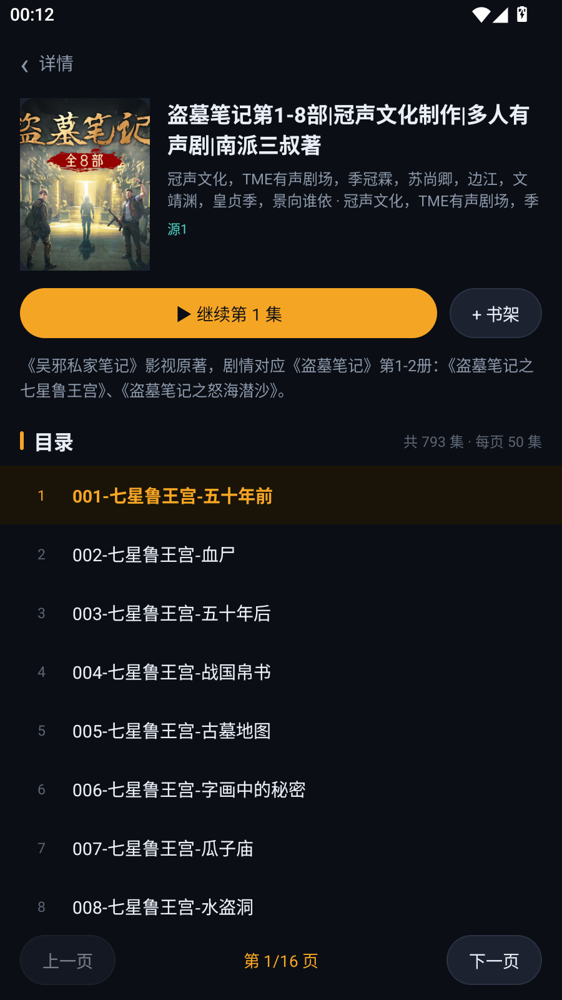

# 拾音 · Shiyin

一个纯原生 Android 听书客户端：无 WebView、无 AndroidX、无 Gradle，`aapt2 + javac + d8` 直接出包。

界面不再内置任何内容源：源由用户自己添加的**在线订阅**提供，应用本身只负责解析和播放。
支持后台播放、系统媒体卡片、耳机线控、分页目录、跨页连播和离线目录缓存。




## 内容源订阅

应用不附带、也不推荐任何具体内容源。要浏览内容，需要自己准备一个订阅 JSON：

- **我的 → 内容源 → 添加订阅**，填入订阅地址（`http://` 或 `https://`）。
- 下载成功后缓存在本地，之后断网也能用；**管理订阅** 里可以刷新或删除。
- 订阅清单和首页推荐均写入本地，自动更新周期统一为 24 小时。周期内不重新请求
  清单或推荐接口；首页切页复用原页面，重启恢复上次推荐。图片及播放等请求独立进行。
- 超过周期后在使用应用时后台静默更新，仍先显示旧推荐。失败保留旧内容并等下一周期，
  避免反复启动或切页重复重试。**刷新全部订阅** / 单项 **立即刷新** 可随时强制更新。
- 推荐按内容源分别缓存，单个源失败不会清空其它板块；源配置改变后重新获取对应推荐。
- 分类支持根分类、子分类筛选及分类书目分页；分类树本地保存 24 小时，失败保留旧分类。
  首次升级 2.8 会后台补刷一次订阅结构，之后继续沿用更新周期。
- 删除订阅会同时移除它提供的源，书架里对应的书将无法继续播放。

订阅格式（`format` 可省略，但写了就必须是 `shiyin-sources`）：

```json
{
  "format": "shiyin-sources",
  "version": 1,
  "name": "我的源",
  "sources": [
    {
      "id": "demo",
      "name": "演示源",
      "desc": "说明文字",
      "headers": { "Referer": "https://example.com/" },
      "search": {
        "url": "https://example.com/api/search?kw={kw}&page={page}",
        "items": "data.list",
        "fields": { "id": "id", "title": "name", "author": "author" }
      },
      "categories": {
        "url": "https://example.com/api/cats",
        "items": "data.cats",
        "fields": { "id": "id", "name": "name", "children": "children" },
        "page": {
          "url": "https://example.com/api/list?cat={cat}&page={page}",
          "items": "data.list",
          "fields": { "id": "id", "title": "name" },
          "hasMore": "data.has_more"
        }
      },
      "detail": {
        "url": "https://example.com/api/book/{id}",
        "meta": "data.book",
        "fields": { "id": "id", "title": "name", "cover": "cover" },
        "chapters": {
          "items": "data.chapters",
          "fields": { "id": "id", "title": "name" },
          "paged": {
            "url": "https://example.com/api/chapters?id={id}&pn={page}",
            "items": "data.list",
            "total": "data.total",
            "hasMore": "data.has_more"
          }
        }
      },
      "play": {
        "url": "https://example.com/api/play?cid={chapterId}",
        "field": "data.url"
      }
    }
  ]
}
```

约定：

- 模板变量：`{kw}`（自动 URL 编码）、`{page}`、`{page0}`、`{page1}`、`{id}`、`{cat}`、`{chapterId}`。
- 路径用点号分隔，纯数字段表示数组下标，例如 `data.list.0.name`；取不到时按空串处理。
- `fields` 把输出字段映射到 JSON 路径，不写则用同名字段。
- `search` / `categories` / `detail` / `play` 都是可选的：没有 `search` 就不出现在搜索页，没有 `paged` 就整本取回后本地每 50 集切片。
- 引擎只发 HTTP 请求和读 JSON，**不执行任何脚本**。

## 功能

**浏览与搜索**

- 首页推荐、分类、搜索都由订阅源提供
- 跨源搜索，搜索历史，旧请求自动作废，不会出现「搜 A 显示 B」
- 书籍详情：封面、作者/演播、简介展开、加入书架

**分页目录**

- 每页固定 50 集，页尾「上一页 / 第 x/y 页 / 下一页」，点页码可输入跳转
- 有缓存先显示再后台刷新；刷新失败保留当前页，照样能播
- 打开书时按上次进度直接落到对应页并定位该行，继续播放恢复原位置
- 历史集数超过最新目录时提示「目录已更新」，不会把你甩回第一集

**播放**

- 前台服务 + `MediaSession`：通知栏/锁屏显示封面、书名、章节、进度，支持播放暂停、上一集下一集、拖动进度、停止
- 音频焦点：来电等临时打断自动暂停、恢复后续播；手动暂停主动放弃焦点
- 耳机拔出自动暂停
- 播放进度每 5 秒落盘，暂停/切页/退出都会补存
- 播放器只持有当前一页 50 集，播到页尾自动加载下一页继续，失败可重试同一目标

**后台存活**

- `mediaPlayback` 前台服务 + `WAKE_LOCK`
- 设置页提供通知权限申请、电池优化白名单入口、厂商自启动说明
- 可选「开机续听提醒」（默认关闭，只发通知不自动播放）

## 技术栈

| 项目 | 选择 |
| --- | --- |
| 语言 | Java 11 |
| UI | Android 原生 View（LinearLayout / ListView / 自绘控件） |
| 最低版本 | minSdk 24，targetSdk 33 |
| 构建 | `aapt2 → javac → jar → d8 → zipalign → apksigner`（无 Gradle） |
| 第三方依赖 | 仅 `jsoup`（解析播客 RSS） |
| 包名 | `com.shiyin.app` |

不用 AndroidX 是刻意的：整个工程 30 个源文件、约 6500 行，加上一个 400KB 的 jar 就能编，
省掉 Gradle、AGP、依赖下载和一堆版本冲突。

## 目录结构

```
native/
├── AndroidManifest.xml
├── build.sh                     # 主包构建脚本
├── assets/catalog.json          # 旧版内置分类表（订阅版不再使用）
├── libs/jsoup.jar               # 唯一的第三方依赖
├── res/                         # 图标、主题、字符串
├── docs/screenshots/            # 说明文档用截图
├── src/com/shiyin/app/
│   ├── App.java                 # 全局初始化（Cookie、Prefs、订阅源注册）
│   ├── MainActivity.java        # 首页 / 分类 / 书架 / 我的
│   ├── model/                   # Book、Chapter、Cat
│   ├── net/                     # Http（带退避重试）、Api、AppUpdate
│   ├── source/                  # 源抽象 + 订阅引擎 + 分页仓库
│   │   ├── Source.java          # 源抽象 + ChapterPage 契约
│   │   ├── JsonSource.java      # 订阅源引擎（模板 + JSON 路径）
│   │   ├── Subscriptions.java   # 订阅下载、缓存、注册
│   │   ├── ChapterRepository.java # 分页缓存与并发合并
│   │   └── Sources.java         # 源注册表（默认不含内置源）
│   ├── play/                    # Player、PlayerService、BootReceiver
│   ├── store/Prefs.java         # 书架、进度、设置、分页缓存
│   ├── ui/                      # 详情、播放、搜索、后台设置、适配器
│   └── util/                    # 图片加载、后台线程、UI 工具
└── tests/                       # 独立 instrumentation 测试 APK
```

## 下载与 GitHub 自动编译

安装包在仓库的 **Releases** 页面下载，附带 `SHA256SUMS` 校验文件。

仓库通过 `.github/workflows/android.yml` 自动构建，不需要在本机安装编译环境：

- 推送到 `main`：自动构建、校验签名并上传 APK 到对应 Actions 运行的 Artifacts（保留 30 天）。
- 手动运行：进入 **Actions → Android APK → Run workflow**。
- 推送 `v` 开头的版本标签：构建成功后自动创建或更新 GitHub Release，上传 APK 与校验文件。
- App 的「我的 → 关于 → 检查更新」会查询最新正式发布；发现新版本后可直接打开对应 Release 页面下载。
- 标签须与 `AndroidManifest.xml` 的 `versionName` 一致，例如 `v2.3` 对应 `2.3`；新版本还应递增 `versionCode`。

云端使用 JDK 17、Android SDK Platform 33 与 Build Tools 34.0.0，直接运行原有构建脚本。
会编译独立测试 APK，但不会在云端启动模拟器执行回归测试。

签名材料只保存在仓库的 **Settings → Secrets and variables → Actions**：
`SHIYIN_KEYSTORE_BASE64`（签名库的 Base64）、`SHIYIN_KEYSTORE_PASS`、`SHIYIN_KEYSTORE_ALIAS`。
当前沿用已有 APK 的开发签名，并校验公开证书指纹，确保后续构建的签名一致。
缺少签名配置时构建会失败，不会临时生成另一套签名。不要把签名库或密码提交到源码。
Fork 仓库需配置自己的 Secrets，并在工作流中更新公开证书指纹；不同签名无法覆盖安装原包。

## 编译

只需要 JDK 17、Android SDK（build-tools 含 `aapt2`/`d8`/`zipalign`/`apksigner`）和 Python 3，
**不需要 Gradle，也不需要任何外部 jar**。脚本支持用环境变量覆盖默认路径：

```bash
export ANDROID_SDK_ROOT=/path/to/android-sdk
export ANDROID_BUILD_TOOLS=$ANDROID_SDK_ROOT/build-tools/34.0.0
export ANDROID_PLATFORM=$ANDROID_SDK_ROOT/platforms/android-33
export JAVA_HOME=/path/to/jdk-17

cd native
bash build.sh
# 产物：build/signed/shiyin.apk
```

签名默认用 `~/.android/debug.keystore`，不存在会自动生成一个，保证克隆下来直接能编。
要打正式包就指定自己的 keystore：

```bash
export SHIYIN_KEYSTORE=/path/to/release.jks
export SHIYIN_KEYSTORE_PASS=******
export SHIYIN_KEYSTORE_ALIAS=your-alias
```

> 两个踩过的坑，脚本里已经绕开：
> 1. `d8.bat` 在 Git Bash 下按 Windows 工作目录解析相对路径，会报
>    `NoSuchFileException`。改成先 `jar cf program.jar`，再用
>    `java -cp d8.jar com.android.tools.r8.D8` 传绝对路径。
> 2. `core.autocrlf=true` 会把 `.sh` 提交成 CRLF，到 Linux 上直接跑不起来。
>    仓库里加了 `.gitattributes` 强制 shell/源码用 LF。

## 测试

测试是**独立 APK**，不会打进正式包：

```bash
cd native
bash build.sh            # 先出主包（测试需要主包的 classes 与 program.jar）
bash tests/build.sh      # 出 tests/build/test.apk

adb install -r build/signed/shiyin.apk
adb install -r tests/build/test.apk
adb shell am instrument -w com.shiyin.test/com.shiyin.test.PlaybackTest
```

当前 **36 项**回归覆盖：

- 目录：载入动画、缓存保留章节 ID、首批只请求第 1 页、部分缓存不冒充整本、
  翻页全局序号、末页条数、失败重试
- 播放：本地音频起播、后台进度推进、暂停/续播、seek、音频焦点抢占与恢复、
  耳机断开、进度落盘、通知栏上一集/下一集、停止释放媒体会话
- 分页播放：第 50→51 集跨页、51→50 回退、自然播完自动跨页、
  跨页请求失败后重试不回第一集、加载中暂停不自动出声、切书旧回调隔离、
  第 101 集历史定位与 seek 恢复、空队列清理

真实接口冒烟（不下载音频，只验证目录）：

```bash
adb shell am instrument -w -e live 1 com.shiyin.test/com.shiyin.test.PlaybackTest
```

## 分页是怎么做的

`Source.chapterPage(Book, int page)` 返回 `ChapterPage`：

```java
public static class ChapterPage {
    public Book meta;
    public List<Chapter> chapters = new ArrayList<>();
    public int page;            // 0 起
    public int total = -1;      // 整本集数，未知为 -1
    public boolean hasMore;
    public boolean networkPaged;  // 是否真的走了服务端分页
}
```

- 订阅里配了 `chapters.paged` 的源走服务端分页：一次只取 50 条，`total` / `hasMore` 决定还有没有下一页。
- 没配 `paged` 的源用默认实现：整本取回后本地切片，带 3 本 / 10 分钟内存缓存与同书请求合并，
  首批仍然要等一次完整请求，只是界面按 50 条分批渲染。
- 缓存写在独立的 `shiyin_chapter_pages`（7 天、每书 24 页、全局 96 页），
  不覆盖旧的整本目录缓存；旧缓存在网络失败时兜底。

## 已知限制

- 应用不内置内容源，首次使用必须自己添加订阅，否则首页、分类和搜索都是空状态。
- 订阅由使用者自行提供，其可用性、合法性和内容质量由订阅作者与使用者负责。
- 部分内容源有付费/试听限制，本客户端不做任何绕过，按接口返回原样处理。
- 厂商「自启动」开关无法可靠读取，设置页只做引导，不保证后台常驻。
- 被系统「强行停止」后不会自动恢复播放。

## 免责声明

本项目仅用于 Android 客户端开发与逆向工程的学习研究，不托管、不分发任何音视频内容，
也不附带任何内容源。所有内容均来自使用者自行添加的第三方订阅。请勿用于商业用途；
由此产生的版权或服务条款问题由使用者自行承担。
若要长期使用，建议接入自己有授权的合法内容源。

仓库未附带开源许可证，默认保留所有权利。
